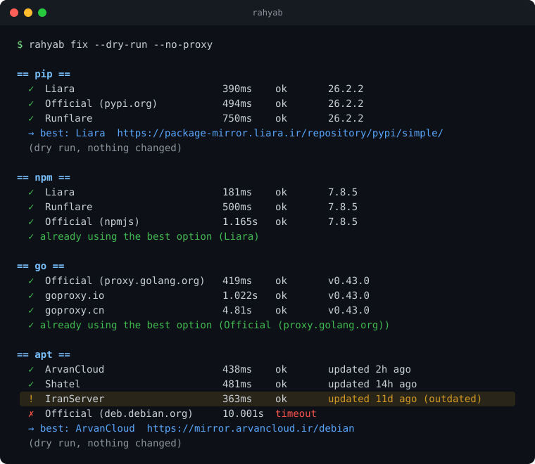

# rahyab 🧭 (راه‌یاب)

<p align="center">
  
</p>

[English](README.md)

**با یک دستور، pip و npm و go و docker و apt دوباره در ایران کار می‌کنند، حتی در زمان قطعی اینترنت.**

راه‌یاب همه‌ی میرورهای شناخته‌شده را *واقعاً* تست می‌کند، بررسی می‌کند به‌روز باشند، بهترین را انتخاب و روی ابزارهایتان تنظیم می‌کند. همه‌چیز با `rahyab undo` برگشت‌پذیر است.

## نمونه

[](docs/demo.svg)

اینجا IranServer **سریع‌ترین** میرور apt است، اما **۱۱ روز عقب** است. ابزاری که فقط سرعت را بسنجد همین را انتخاب می‌کرد. راه‌یاب آن را کنار گذاشت و ArvanCloud را انتخاب کرد که ۲ ساعت پیش به‌روز شده است.

## چرا راه‌یاب؟

- **ساخته‌شده برای قطعی.** وقتی اینترنت بین‌الملل قطع است، راه‌یاب در کمتر از ۳ ثانیه متوجه می‌شود و فقط از میرورهای داخلی استفاده می‌کند. لیست میرورها داخل خود برنامه است و به هیچ چیزی بیرون از ایران نیاز ندارد.
- **درخواست واقعی، نه ping.** از هر میرور دقیقاً همان چیزی را می‌خواهد که ابزار شما می‌خواهد و درستی جواب را بررسی می‌کند. برای داکر مراحل واقعی pull را انجام می‌دهد (گرفتن توکن و بعد manifest). برای Go پایگاه checksum را هم بررسی می‌کند، که در زمان قطعی بدون آن `go get` کار نمی‌کند.
- **به‌روز بودن، نه فقط سرعت.** نسخه‌ی پکیج‌ها و تاریخ به‌روزرسانی apt را مقایسه می‌کند. میرورهایی که بیش از ۲ روز عقب‌اند کنار گذاشته می‌شوند، و بین دو میرور با سرعت نزدیک، آن که تازه‌تر است برنده می‌شود.
- **میرور پشتیبان.** داکر تا ۳ میرور و Go دو میرور می‌گیرد، تا قطع شدن یک میرور کارتان را متوقف نکند.
- **تغییر بی‌دلیل نمی‌دهد.** اگر منبع اصلی بهترین باشد (مثلاً با VPN)، همان را نگه می‌دارد.
- **امن.** اطلاعات undo قبل از هر تغییری ذخیره می‌شود، فایل‌ها طوری نوشته می‌شوند که هیچ‌وقت نیمه‌کاره نمانند، و اگر داکر با تنظیم جدید بالا نیاید خودکار به حالت قبل برمی‌گردد. مخزن‌های امنیتی و مخزن‌های جانبی apt (مثل داکر و PPAها) هرگز دست نمی‌خورند.
- **یک فایل اجرایی** برای لینوکس، مک و ویندوز. بدون نیاز به پایتون.

## نصب

**لینوکس و مک**

```
curl -fsSL https://raw.githubusercontent.com/Ali30mhi/rahyab/main/install.sh | sh
```

نسخه‌ی مناسب سیستم شما را خودش انتخاب می‌کند و checksum آن را بررسی می‌کند.

**ویندوز:** فایل `rahyab-windows-amd64.exe` را از [Releases](https://github.com/Ali30mhi/rahyab/releases) دانلود و در PowerShell اجرا کنید.

**به GitHub دسترسی ندارید؟** فایل مخصوص سیستمتان را همراه با `checksums.txt` از کسی بگیرید که آن را دارد (مثلاً از یک گروه تلگرامی یا با فلش)، و قبل از اجرا بررسی‌اش کنید:

```
sha256sum rahyab-linux-amd64            # لینوکس
shasum -a 256 rahyab-darwin-arm64       # مک
Get-FileHash rahyab-windows-amd64.exe   # ویندوز (PowerShell)
```

عدد به‌دست‌آمده باید با خط همان فایل در `checksums.txt` یکی باشد. بعد در لینوکس و مک: `chmod +x rahyab-* && sudo mv rahyab-* /usr/local/bin/rahyab`

## استفاده

```
rahyab doctor            # چه چیزی بسته است؟ (چیزی را تغییر نمی‌دهد)
rahyab fix               # pip و npm و go (تنظیمات کاربر شما)
sudo rahyab fix          # docker و apt (تنظیمات سیستم)
rahyab fix pip npm       # فقط این‌ها
rahyab fix --dry-run     # فقط نشان بده چه چیزی عوض می‌شود
rahyab status            # تنظیمات فعلی
rahyab undo              # برگرداندن (برای docker و apt با sudo)
rahyab undo npm          # برگرداندن فقط یک ابزار
```

**VPN روشن است؟** راه‌یاب به‌طور پیش‌فرض از همان مسیری تست می‌کند که ابزارهای شما استفاده می‌کنند (از جمله `HTTP(S)_PROXY`)، پس نتیجه همین حالا برای شما کار می‌کند. برای تست شبکه‌ی مستقیم ایران، `--no-proxy` را اضافه کنید.

**برای Dockerfile و اسکریپت:** گزینه‌ی `--print` به جای اجرا، دستورها را نشان می‌دهد. آن را روی سیستم خودتان اجرا کنید و خروجی را در یک خط `RUN` بگذارید:

```
rahyab fix pip apt --print --no-proxy
```

**تنظیمات اثر نمی‌کند؟** متغیرهای `PIP_INDEX_URL` و `NPM_CONFIG_REGISTRY` و `GOPROXY` در shell شما بر فایل‌های تنظیمات اولویت دارند. راه‌یاب اگر یکی از آن‌ها تنظیم شده باشد به شما خبر می‌دهد.

## در زمان قطعی اینترنت

- **راه‌یاب را از همین حالا داشته باشید.** بعد از نصب، کاملاً بدون اینترنت خارجی کار می‌کند.
- **DNS را بررسی کنید.** اگر DNS شما خارج از ایران است (مثل `8.8.8.8` یا `1.1.1.1`)، در قطعی هیچ آدرسی پیدا نمی‌شود، حتی آدرس میرورهای داخلی. از DNS اینترنت‌دهنده‌ی خودتان استفاده کنید. `rahyab doctor` این را برایتان بررسی می‌کند.
- **Go:** راه‌یاب میرورهایی را ترجیح می‌دهد که پایگاه checksum را هم دارند. اگر تنها میرور سالم آن را نداشته باشد، می‌گوید چطور این بررسی را خاموش و بعداً دوباره روشن کنید.
- **بعضی میرورها فقط کش نگه می‌دارند.** این میرورها فقط بسته‌هایی را دارند که کسی قبل از قطعی دانلود کرده. راه‌یاب این‌ها را مشخص می‌کند.
- **لیست میرورها:** وقتی اینترنت وصل است، راه‌یاب روزی یک بار آخرین لیست را از همین مخزن می‌گیرد و نگه می‌دارد، پس میرورهای جدید بدون نیاز به نسخه‌ی جدید به دست شما می‌رسند.

## پشتیبانی

| ابزار  | خودکار   | توضیح                                              |
|--------|----------|----------------------------------------------------|
| pip    | ✅        | تنظیم کاربر، بدون root                             |
| npm    | ✅        | تنظیم کاربر، بدون root                             |
| go     | ✅        | `GOPROXY` با یک میرور پشتیبان                      |
| docker | ✅ لینوکس | تا ۳ میرور؛ Docker Desktop: تنظیم را برای کپی نشان می‌دهد |
| apt    | ✅ لینوکس | مخزن اصلی اوبونتو و دبیان، با sudo                 |

## مشارکت

میرور خوبی می‌شناسید؟ آن را به `mirrors.json` اضافه کنید و PR بفرستید. نیازی به بلد بودن Go نیست. اول با `rahyab fix --dry-run --mirrors=mirrors.json` تستش کنید. ارزشمندترین میرورها آن‌هایی‌اند که داخل ایران‌اند و در قطعی هم کار می‌کنند.

داده‌های میرورها بر پایه‌ی پروژه‌ی جامعه‌محور [Mirava](https://github.com/MiravaOrg/Mirava) است. ممنون از آن‌ها!

## مجوز

MIT
