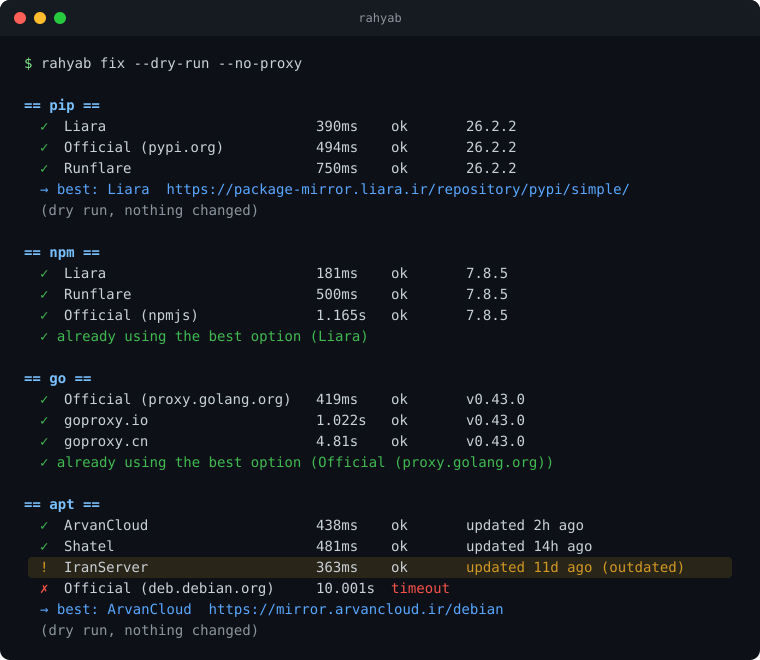

# rahyab 🧭

[فارسی](README.fa.md)

**One command, and pip, npm, go, docker and apt work again in Iran, even during an internet shutdown.**

rahyab tests every known mirror *for real*, checks that each one is up to date, picks the best one and configures your tools. Everything is reversible with `rahyab undo`.

## Example

[](docs/demo.svg)

Here IranServer is the **fastest** apt mirror, but it's **11 days behind**. A tool that only measures speed would pick it. rahyab skips it and picks ArvanCloud, updated 2 hours ago.

## Why rahyab

- **Built for shutdowns.** When the international internet is down, rahyab notices within 3 seconds and uses Iranian mirrors only. The mirror list is built in, so it needs nothing from outside Iran.
- **Real requests, not ping.** It asks each mirror for exactly what your package manager would, and checks the answer. For Docker it does the real pull handshake (token, then manifest). For Go it also checks the checksum database, without which `go get` fails during a shutdown.
- **Freshness, not just speed.** Compares package versions and apt release dates. Mirrors more than 2 days behind are skipped, and between two close mirrors the fresher one wins.
- **Fallbacks.** Docker gets up to 3 mirrors and Go gets 2, so one mirror going down doesn't break your build.
- **No change for the sake of change.** If the official source is the best (e.g. on a VPN), it keeps it.
- **Safe.** Undo info is saved before anything is touched, files are written atomically, and if Docker won't start with the new config it's rolled back. Security repos and third-party apt repos (Docker's, PPAs) are never touched.
- **Single binary** for Linux, macOS and Windows. No Python.

## Install

**Linux and macOS**

```
curl -fsSL https://raw.githubusercontent.com/Ali30mhi/rahyab/main/install.sh | sh
```

It picks the right build for your system and verifies its checksum.

**Windows:** download `rahyab-windows-amd64.exe` from [Releases](https://github.com/Ali30mhi/rahyab/releases) and run it in PowerShell.

**Can't reach GitHub?** Get the file for your system from someone who has it (a Telegram group, a USB stick) together with `checksums.txt`, and check it before running it:

```
sha256sum rahyab-linux-amd64            # Linux
shasum -a 256 rahyab-darwin-arm64       # macOS
Get-FileHash rahyab-windows-amd64.exe   # Windows PowerShell
```

The result must match the line for that file in `checksums.txt`. Then on Linux/macOS: `chmod +x rahyab-* && sudo mv rahyab-* /usr/local/bin/rahyab`.

## Usage

```
rahyab doctor            # what's blocked? (changes nothing)
rahyab fix               # pip, npm, go (your user settings)
sudo rahyab fix          # docker, apt (system settings)
rahyab fix pip npm       # only these
rahyab fix --dry-run     # show what would change
rahyab status            # current settings
rahyab undo              # restore (sudo rahyab undo for docker/apt)
rahyab undo npm          # restore just one tool
```

**On a VPN?** By default rahyab tests the same route your tools use (including `HTTP(S)_PROXY`), so the result works for you right now. Add `--no-proxy` to test the direct Iranian network instead.

**Dockerfiles and scripts:** `--print` shows the commands instead of running them. Run it on your machine and put the output in a `RUN` line:

```
rahyab fix pip apt --print --no-proxy
```

**Settings not taking effect?** `PIP_INDEX_URL`, `NPM_CONFIG_REGISTRY` and `GOPROXY` in your shell override config files. rahyab tells you when one is set.

## During an internet shutdown

- **Get rahyab now.** It works fully offline once you have it.
- **Check your DNS.** If your DNS server is outside Iran (like `8.8.8.8` or `1.1.1.1`), nothing resolves during a shutdown, not even Iranian mirrors. Use your ISP's DNS. `rahyab doctor` checks this for you.
- **Go:** rahyab prefers mirrors that serve Go's checksum database. If the only working one doesn't, it tells you how to turn the check off and back on.
- **Some mirrors are caches.** They only have packages someone downloaded before the shutdown. rahyab points these out.
- **Mirror list:** while the internet is up, rahyab fetches the latest list from this repo once a day and keeps a copy, so new mirrors reach you without a new version.

## Supported

| Tool   | Automatic | Notes                                                       |
|--------|-----------|-------------------------------------------------------------|
| pip    | ✅        | user config, no root                                        |
| npm    | ✅        | user config, no root                                        |
| go     | ✅        | `GOPROXY`, with a fallback mirror                           |
| docker | ✅ Linux  | up to 3 mirrors; Docker Desktop: shows the setting to paste |
| apt    | ✅ Linux  | Ubuntu/Debian main archive, needs sudo                      |

## Contributing

Know a mirror? Add it to `mirrors.json` and open a PR. No Go knowledge needed. Test it first with `rahyab fix --dry-run --mirrors=mirrors.json`. Mirrors inside Iran that work during a shutdown are the most valuable.

Mirror data is based on the community-maintained [Mirava](https://github.com/MiravaOrg/Mirava) project. Thank you!

## License

MIT
